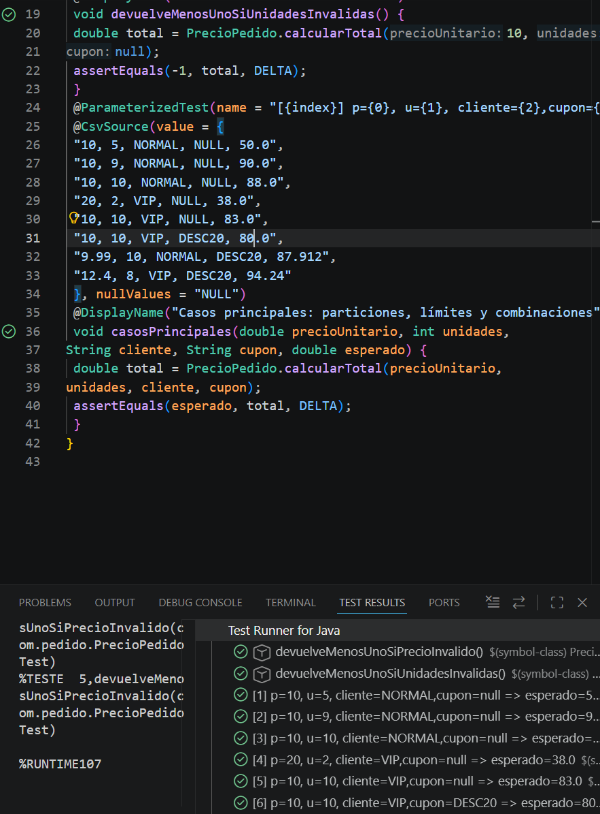

# Tarea 5: Configuración de Entorno y Pruebas Unitarias con JUnit 5
Ejercicio práctico del módulo Entornos de Desarrollo para configurar Maven, integrar JUnit 5 en IntelliJ IDEA, diseñar e implementar casos de prueba automatizados y analizar la cobertura de código.

## 🚀 Resultado Visual


## 🛠️ Tecnologías utilizadas
- Java / IntelliJ IDEA
- Maven & Maven Surefire Plugin
- JUnit 5 (JUnit Jupiter Engine & Parameterized Tests)

## 📋 ¿Qué se hizo? (Funcionalidades)
- Configuración de la estructura de proyecto Maven (`pom.xml`) gestionando dependencias con ámbito de prueba (`scope=test`).
- Implementación de la clase de negocio `PrecioPedido` para el cálculo de totales según reglas de descuento e imputación de límites.
- Diseño de la suite de pruebas `PrecioPedidoTest` incluyendo tests unitarios simples (`@Test`) y tests parametrizados (`@ParameterizedTest`, `@CsvSource`).
- Verificación de condiciones de frontera, validación de entradas inválidas e intercalado de cupón de descuento acumulable vs no acumulable.
- Ejecución de pruebas y análisis de cobertura de código (*Run with Coverage*) para garantizar el paso por todas las ramas de decisión.
- Refactorización guiada (mini-regresión) actualizando reglas de descuento del 10% al 12% y validando la consistencia del software.

## ⚙️ Cómo ejecutarlo localmente
1. Abre el proyecto en IntelliJ IDEA y asegúrate de cargar los cambios de Maven (*Reload All Maven Projects*).
2. Transpila y ejecuta la suite de pruebas unitarias desde la terminal ejecutando:
   ```bash
   mvn test