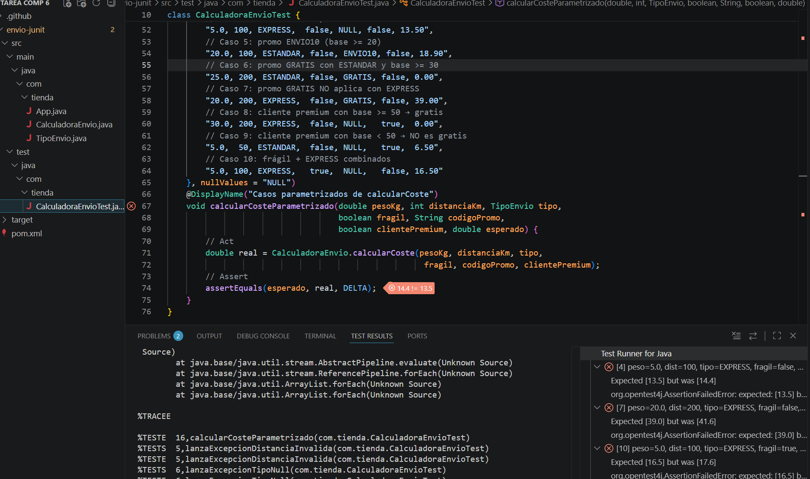

# Tarea 6: Calculadora de Envíos con JUnit 5
Ejercicio práctico del módulo Entornos de Desarrollo (RA3) para diseñar e implementar la lógica de una calculadora de envíos, automatizar pruebas unitarias con JUnit 5, validar excepciones y analizar la cobertura de código.

## 🚀 Resultado Visual


## 🛠️ Tecnologías utilizadas
- Java / IntelliJ IDEA
- Maven & Maven Surefire Plugin
- JUnit 5 (JUnit Jupiter, `@Test`, `@ParameterizedTest`, `assertThrows`)

## 📋 ¿Qué se hizo? (Funcionalidades)
- Creación de la estructura del proyecto Maven con la definición de la enumeración `TipoEnvio` y la clase de producción `CalculadoraEnvio`.
- Implementación de la lógica de negocio para el cálculo de costes de envío considerando peso, distancia, recargos por fragilidad, multiplicador express, promociones y beneficio de cliente premium.
- Validación de parámetros de entrada con lanzamiento de excepciones (`IllegalArgumentException`) ante valores no válidos.
- Creación de la suite de pruebas `CalculadoraEnvioTest` con comprobaciones de excepciones mediante `assertThrows`.
- Implementación de pruebas parametrizadas (`@ParameterizedTest` y `@CsvSource`) cubriendo casos de uso de caja negra, análisis de valores límite y particiones de equivalencia.
- Ejecución de análisis de cobertura de código (*Run with Coverage*) superando el objetivo del 90% de líneas cubiertas.
- Simulación de cambio de requerimientos (ajuste del multiplicador EXPRESS de 1.50 a 1.60), gestión de fallos de regresión y actualización de los valores esperados.

## ⚙️ Cómo ejecutarlo localmente
1. Abre el proyecto en IntelliJ IDEA y asegúrate de sincronizar las dependencias de Maven.
2. Transpila el proyecto y ejecuta la suite completa de pruebas unitarias ejecutando en la terminal:
   ```bash
   mvn test